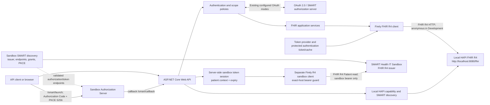

# .NET FHIR Integration Architecture

The API and FHIR service are separate from authentication. Firely handles typed FHIR resource serialization and REST interactions. A bearer-token handler asks the configured token provider for a token on each outgoing request. Anonymous mode returns no token by explicit configuration; OAuth modes fail if token acquisition fails. Read retries are limited to safe HTTP methods.

The current local HAPI connector and SMART Sandbox connector have independent base URLs and authentication. Local requests use the existing local HAPI configuration and do not receive a sandbox bearer token. The sandbox OAuth handler uses ASP.NET Core OAuth middleware for protected state/correlation and PKCE S256; its bearer token remains in a process-local server-side session store. Sandbox FHIR requests are blocked unless their destination is beneath the exact configured sandbox issuer. Neither connection falls back to the other. SMART Backend Services remains a separate flow and was not part of this browser launch.
